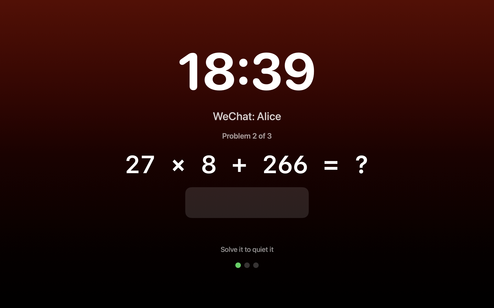
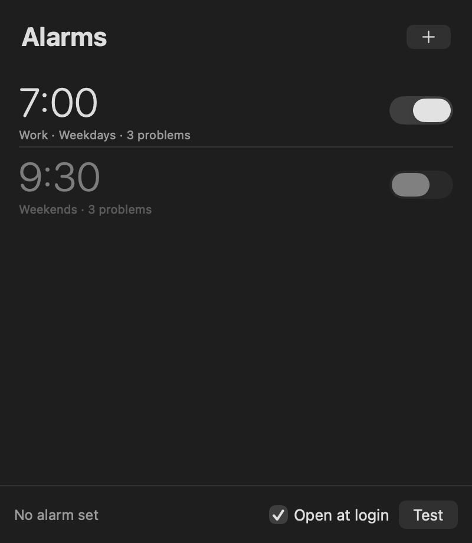
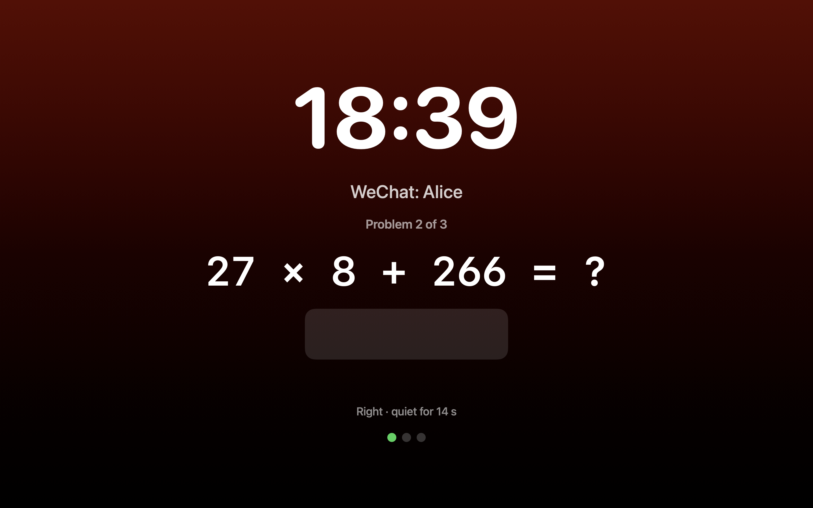
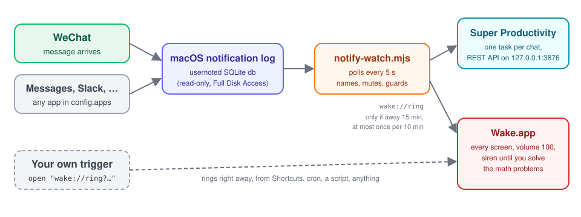

# Wake

A Mac alarm you can't snooze, plus triggers that ring it when someone messages you.

When it rings, Wake covers every screen, blocks Cmd-Tab, Force Quit, and Quit, turns the volume to 100 and unmutes, and plays a harsh siren. The only way to stop it is to solve math problems. The included watcher reads macOS notifications, so a WeChat message (or a message from any app you choose) can put a task on your [Super Productivity](https://github.com/super-productivity/super-productivity) list and wake you up.

<p align="center"></p>

| Alarm list (menu bar app) | After a right answer, the siren is quiet |
|---|---|
|  |  |

## How it fits together

<p align="center"></p>

| Piece | File | What it does |
|---|---|---|
| Wake.app | `app/main.swift` | The menu bar alarm app. It handles repeating and one-time alarms and the `wake://ring` URL trigger. It is a single Swift file and needs no Xcode project. |
| Watcher | `triggers/notify-watch.mjs` | Every 5 s it reads new rows from the macOS notification log for the apps you list. For each chat it creates or updates a Super Productivity task, then rings Wake. |
| Ring trigger | `triggers/wake-ring.mjs` | Opens `wake://ring`, with guards: it rings only when you have been away from the Mac, at most once per gap, never in quiet hours, and only when someone is home. |
| Presence | `triggers/presence.mjs` | Checks whether you're home by looking for your phone on the Mac's network. If you've left, it skips the ring. |
| Super Productivity client | `triggers/super-productivity.mjs` | Talks to Super Productivity's local REST API. It keeps one open task per chat and makes a new task after you tick the old one done. |
| Config | `~/.config/wake/config.json` | Sets apps, chat names, mutes, and ring settings. See `config.example.json`. |
| LaunchAgent | `launchd/` | Runs the watcher at login and keeps it running. |

Nothing leaves your Mac. The watcher reads a local SQLite file, talks to Super Productivity on `127.0.0.1`, and opens a URL.

## Install

Requirements: macOS 14 or later, the Xcode command line tools (`xcode-select --install`), and Node 22.13 or later.

```bash
git clone https://github.com/tario-you/alarmly-mac.git
```

```bash
cd alarmly-mac && app/build.sh
```

This builds `Wake.app`, installs it to `/Applications`, registers `wake://`, and launches it. On first launch Wake opens its alarm window and adds itself as a login item. The first time it changes the volume, macOS asks you to let Wake control System Events. Allow it.

Ring it once by hand to check it works. Two problems will stop it:

```bash
open -g "wake://ring?label=Hello&problems=2"
```

Run the app's own checks. These are silent and never take over the screen:

```bash
npm run selftest && npm test
```

### Wire up WeChat and Super Productivity

1. In WeChat for Mac, go to Settings > Notifications. Turn on notifications and, if you want the message text in your tasks, Message Preview. With preview off you get "You've received a message" and the chat id only.
2. In Super Productivity (the desktop app), go to Settings > Misc and turn on Local REST API. The watcher reads the token the app writes to `~/Library/Application Support/superProductivity/local-rest-api-token`.
3. Copy the example config and edit it:

   ```bash
   mkdir -p ~/.config/wake && cp config.example.json ~/.config/wake/config.json
   ```

4. Grant Full Disk Access to whatever runs `node`. The notification log lives in a protected folder. In a terminal, add Terminal or iTerm under System Settings > Privacy & Security > Full Disk Access. For the LaunchAgent, add the `node` binary itself (the installer prints its path).
5. Try the whole chain with a fake message. It makes a task and rings now, ignoring the guards:

   ```bash
   node triggers/notify-watch.mjs test "Alice" "see you at 9"
   ```

6. Run it in the background at login:

   ```bash
   launchd/install.sh
   ```

   The log is in `~/.local/state/wake/watch.log`. To remove it, run `launchd/install.sh --remove`.

## Customize

### Which apps count

`apps` maps bundle ids to the name shown on the alarm. Find an app's id with `osascript -e 'id of app "Slack"'`.

```json
"apps": {
  "com.tencent.xinWeChat": "WeChat",
  "com.apple.MobileSMS": "Messages",
  "com.tinyspeck.slackmacgap": "Slack",
  "ru.keepcoder.Telegram": "Telegram"
}
```

For WeChat, each chat is its WeChat id (`wxid_…`, or `NNN@chatroom` for a group). For other apps, the chat is the notification's title (usually the sender's name).

### Name, mute, or allow-list chats

See which chat ids came in recently. This prints JSON lines and changes nothing:

```bash
node triggers/notify-watch.mjs peek --hours 24
```

Then name them in `names`. A name of `"-"` mutes a chat completely: no task and no ring.

```json
"names": {
  "wxid_abc123": "Alice",
  "12345678@chatroom": "Project group",
  "wxid_family": "-"
},
"ringFor": "all"
```

| Setting | Values | Effect |
|---|---|---|
| `ringFor` | `"all"` (default), `"named"` | With `"named"`, only chats listed in `names` make tasks and ring. |
| `saveText` | `"all"` (default), `"named"`, `"none"` | Controls whether the message text goes into the task notes. |

### When it rings

```json
"ring": {
  "enabled": true,
  "problems": 2,
  "gapMinutes": 10,
  "awayMinutes": 15,
  "quietHours": { "from": "09:00", "to": "23:00" }
}
```

| Key | Default | Meaning |
|---|---|---|
| `enabled` | `true` | Set to `false` to only make tasks and never ring. |
| `problems` | `2` | Number of math problems to stop it (1 to 10). |
| `gapMinutes` | `10` | At most one ring per this many minutes. Messages in between still become tasks. |
| `awayMinutes` | `15` | Ring only when the Mac has had no keyboard or mouse input this long, which means you are asleep or away. Set it to `0` to always ring. |
| `quietHours` | `null` | Never ring between these local times. The range can wrap past midnight. |

### Don't ring when nobody's home

Being away from the Mac for 15 minutes also looks like leaving the house. To avoid ringing an empty home, Wake can check for your phone on the Mac's network first:

```bash
node triggers/presence.mjs find
```

That lists the iPhones and iPads advertising on your network, for example `Your-iPhone.local`. Put yours in the config:

```json
"presence": { "enabled": true, "devices": ["Your-iPhone.local"], "probeSeconds": 8 }
```

Before each ring, the trigger resolves that name and sends one UDP packet to the phone's mDNS port, which wakes a dozing iPhone's Wi-Fi. It then pings the phone for up to `probeSeconds`. It also counts the phone as home if the phone answers IPv6 neighbor discovery, which a sleeping iPhone does even when it ignores ping. If nothing answers, or the name doesn't resolve, nobody's home and it skips the ring. The message still becomes a task. If you list several devices (yours and a partner's), any one of them answering counts as home.

To check it now:

```bash
node triggers/presence.mjs
```

A phone with Wi-Fi off, in Airplane Mode, or with a dead battery reads as away, so Wake won't ring. Leave Wi-Fi on overnight if you rely on it.

To check whether it would ring right now:

```bash
node triggers/wake-ring.mjs why
```

### Super Productivity

```json
"superProductivity": { "enabled": true, "projectId": "INBOX_PROJECT" }
```

Tasks go to the Inbox by default. To use a project instead, get its id with `GET /projects` on the local API and put it in `projectId`. Each chat gets one task, titled `Nov 11: Alice wrote on WeChat, 3 new since 23:30`, with each message's time and text in the notes. When you tick the task done, the next message from that chat starts a new task. Set `enabled` to `false` to ring without making tasks.

### Your own triggers

Anything that can open a URL can ring Wake right away. This path skips the watcher's guards:

```bash
open -g "wake://ring?label=Standup%20in%205&problems=1"
```

To go through the guards (away from the Mac, gap, quiet hours) instead, use:

```bash
node triggers/wake-ring.mjs ring "Build failed"
```

Some ideas:

- Shortcuts: add an Open URLs action with `wake://ring?label=…`, then run it from a Focus change, a calendar event, or an automation.
- cron or launchd: run `open -g "wake://ring?label=Bedtime"` at a fixed time.
- A long job: `make release || open -g "wake://ring?label=Release%20failed"`
- A new app in the watcher: add its bundle id to `apps`. No code change is needed.

Wake rings for anyone who opens a `wake://ring` URL on your Mac. Browsers ask before opening a custom URL scheme, but local apps don't. To stop it, solve the problems.

### The app itself

Everything is in `app/main.swift`:

| What | Where |
|---|---|
| Problem difficulty | `Problem.random()`, default `a × b + c` with a 13–49, b 3–9, c 101–399 |
| Siren sound | `Siren.wav()`, which generates a 2 s loop of 880 and 1320 Hz square-wave beeps |
| Quiet after a right answer | `Ringer.quietFor`, default 20 s; typing alone never quiets it |
| Safety cap | `Ringer.enforce()` stops the alarm after 1 hour |
| What gets locked | `Ringer.lockOptions` |
| Bundle id | `BUNDLE_ID=com.you.wake app/build.sh`. The alarms are stored in that defaults domain. |

Run `app/build.sh` again after any change. Your alarms survive a rebuild.

## Notes

- While an alarm is armed, Wake keeps the Mac from idle sleep. A closed lid still sleeps it, and a Mac that wakes up late still rings if it is within 15 minutes of the alarm time.
- The watcher reads `~/Library/Group Containers/group.com.apple.usernoted/db2/db`. macOS removes a notification row when you clear it from Notification Center, but the watcher has already read it by then (it polls every 5 s).
- If Super Productivity is closed, the watcher still rings and logs the failed task. It does not retry that message.
- State lives in `~/.local/state/wake/` (mode 0700). Nothing is sent anywhere.

## License

MIT
